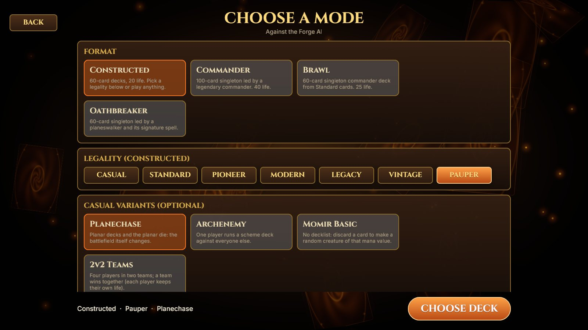
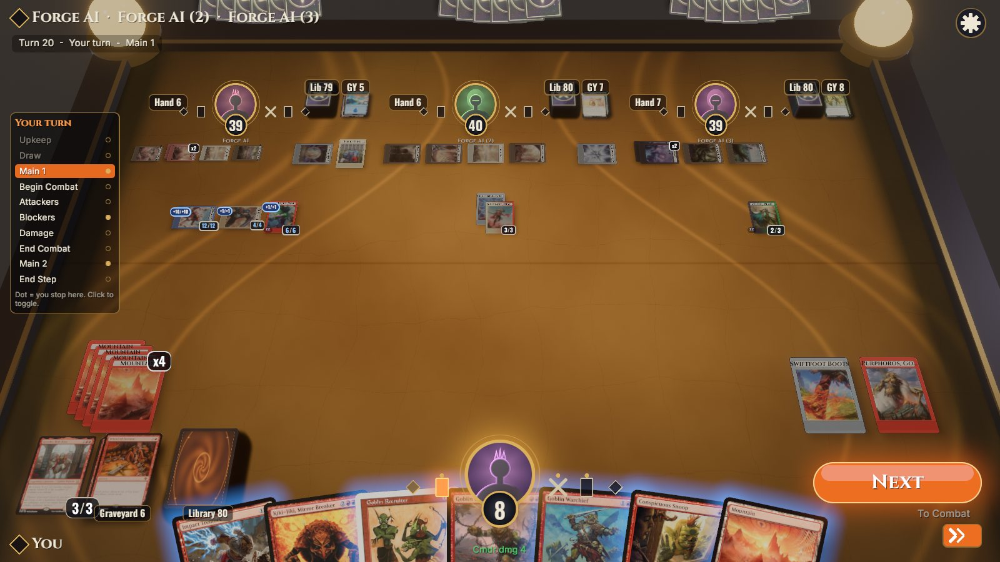
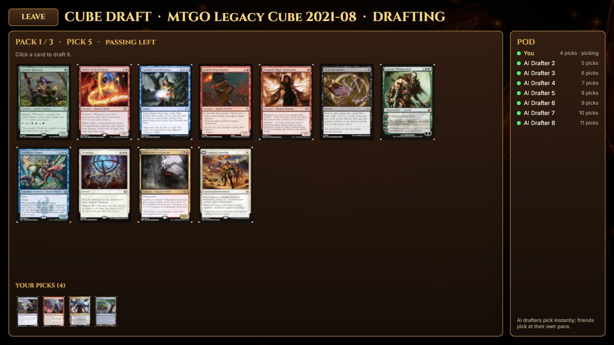
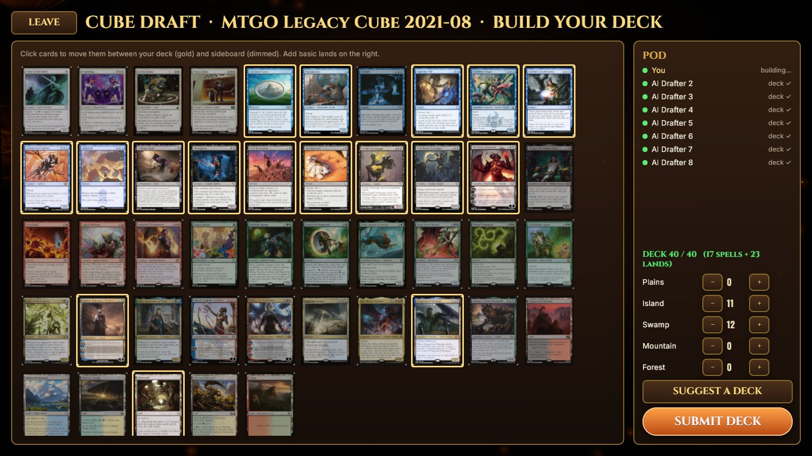
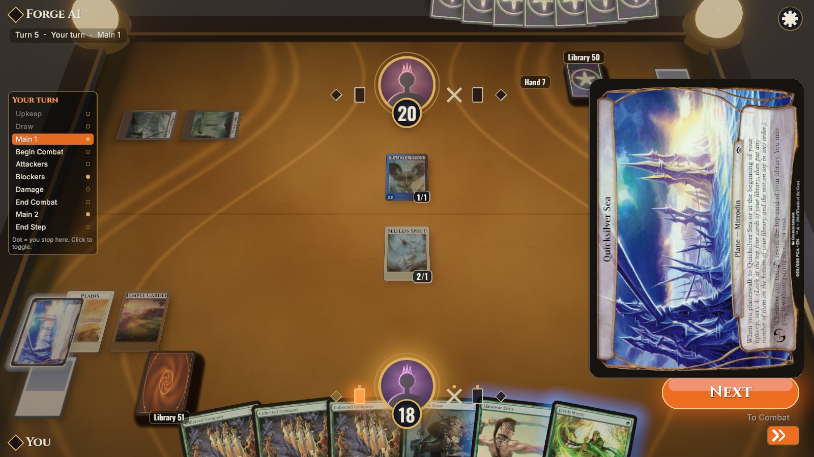
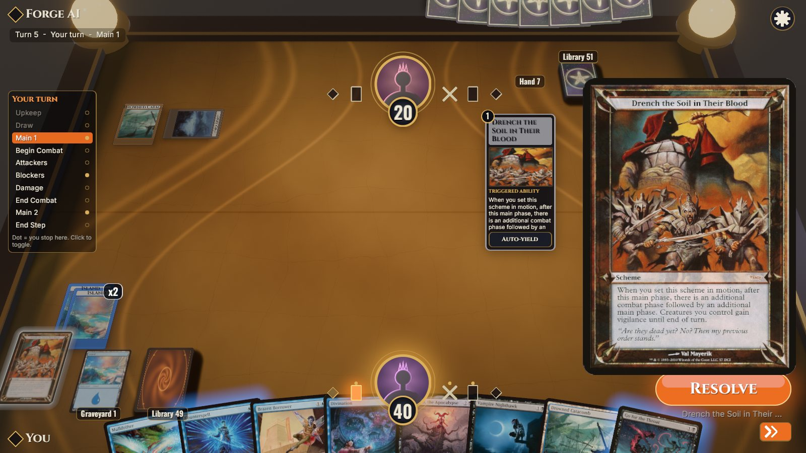
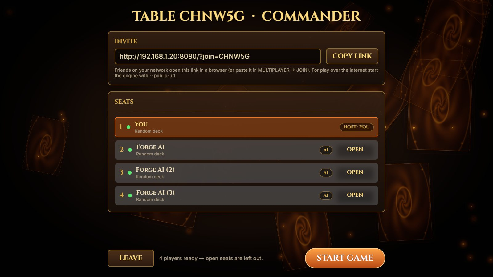
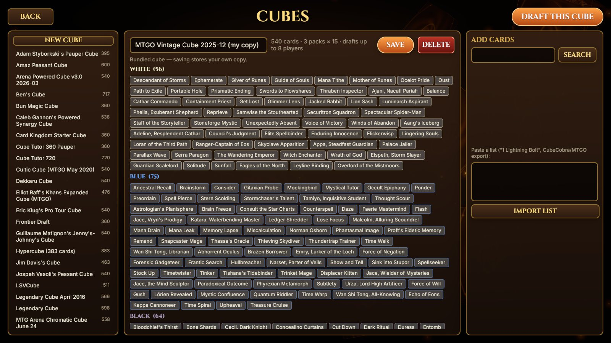
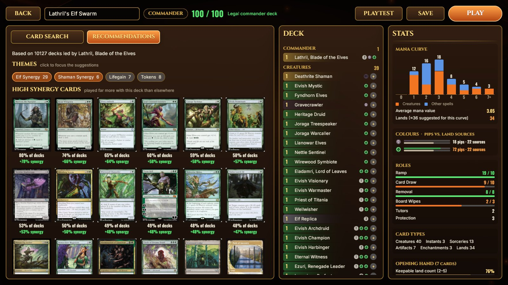
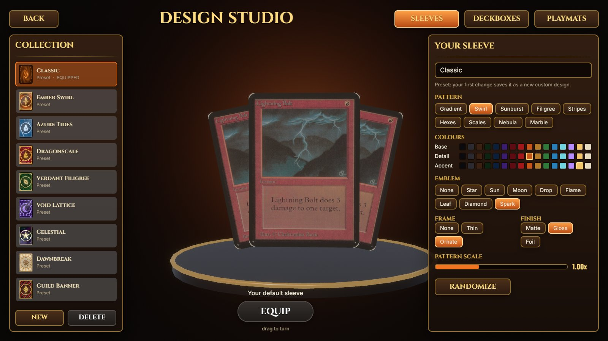

<div align="center">

# MTG Duelstone

**A desktop Magic: The Gathering client written in Rust + Bevy:<br>
a tilted 3D table, art-framed cards, targeting arrows and the full rules engine behind it.**

Play the Forge AI or up to three friends in **Constructed** (Casual to Vintage, Pauper), **Commander**, **Brawl**
and **Oathbreaker**, with **Planechase**, **Archenemy**, **Momir Basic** and **2v2 teams** on top, or draft a
**cube**, a **set** or **sealed**. Everything runs on your machine: no internet needed once the card images are
downloaded.


</div>

---

## Gallery

| | |
|:---:|:---:|
|  |  |
| **Choose a mode.** Format, Constructed legality and casual variants, here Pauper with Planechase | **Four at one table.** A Commander free-for-all against three Forge AI players |
|  |  |
| **Cube draft.** The MTGO Legacy Cube in a pod of eight, AI drafters in the empty seats | **Build your deck.** 40 cards from your picks, basics on the right, or *Suggest a deck* |
|  |  |
| **Planechase.** The current plane in the big preview; the Planar Dice sit in your command zone | **Archenemy.** 40 life and a scheme deck against everyone else |
|  |  |
| **The lobby.** Copy the invite link, give empty seats to the AI, start | **Cube designer.** Edit a copy of any of the 94 bundled cubes or build your own |
|  |  |
| **Main menu.** Play · Multiplayer · Cubes · Decks · Customize · Settings | **Choose your deck.** Every deck in its box; pick the AI's deck or Random |
|  |  |
| **Commander.** Krenko's goblin tokens stack up (x5), elves (x11), commander damage | **The stack.** The AI counters your spell; the button reads *Resolve* |
|  |  |
| **Deck builder.** Offline EDHREC-style suggestions, live mana curve, colour sources and role counts | **Design Studio.** Sleeves, deckboxes and playmats from presets or your own designs |
|  |  |
| **Hover preview & mana payment.** Big card on the right, cost pips, Auto Pay | **Prompts.** Every engine question gets a dialog, e.g. trample damage assignment |

## Features

- **Full Magic rules.** The [Forge](https://github.com/Card-Forge/forge) engine (~33 000 scripted cards) runs
  headless and decides everything: priority, the stack, combat, triggers, layers, mulligans and the AI. The
  client never computes legality. It renders what the engine says and answers its questions.
- **Every way to play.** Four formats with Constructed legality checks, four casual variants, cube draft, set
  draft and sealed, against the AI or at a table of up to four. See [Game modes](#game-modes).
- **Multiplayer, up to 4 players.** Host a table and send the invite link; friends join from a browser with nothing
  to install. Forge AI fills any empty seat, and three- and four-player games lay the opponents out in columns
  across the far side of the table.
- **Plays offline.** The engine, the AI, card images, rulings and suggestions are all local; nothing goes online
  while you play. Multiplayer needs only your local network.
- **Runs in the browser.** The same Bevy client compiles to WebAssembly (WebGL2), and the engine serves it to
  invitees.
- **A 3D card table.** Perspective camera over a themed playmat (Sanctum, Jungle, Storm), fanned hand on its
  own overlay camera, lands and tokens grouped into "x4" stacks, piles with counters, a stack column and a big
  hover preview.
- **Art-framed battlefield cards.** A custom WGSL material puts the art crop in a frame coloured by the card's
  colours, with name bars, P/T plates (buffs blue, damage red), loyalty and counter badges, and glow rims for
  playable, selected and targetable cards.
- **Readable interaction.** Glowing bezier targeting arrows, attack and block ribbons, the orange action
  button ("Next / To Combat", "Attack with 3", "No Blocks"…), phase track with stop toggles, auto-yield per
  stack item, a game log and undo.
- **Every prompt kind.** Confirm, options, ability choice, card trays, ordering triggers, combat damage
  assignment, distribute amounts, scry/surveil, X values and the mulligan screen.
- **Feel.** Spring-damped card motion, floating damage numbers, hit shake, spark bursts, land-drop dust, turn
  banners, victory confetti, synthesized sound effects and ambient music that crossfades between menus and
  matches.
- **Decks.** Four Constructed and two Commander starter decks, Forge's precon and theme decks, and an importer
  for pasted lists (MTGO, Moxfield and other common export formats) that shows unresolved names with suggestions.
- **Sleeves, deckboxes and playmats** (CUSTOMIZE in the main menu or on the deck screen). The Design Studio
  ships presets and lets you design your own from patterns, colours, emblems, frames and finishes, with a live
  3D preview. Choices can be a default or per deck. Deck tiles show each deck's box, and the AI gets its own
  sleeve. Designs are painted procedurally and saved to `~/.config/mtg-duelstone/designs.json`.
- **Deck builder & tester** (NEW DECK / EDIT DECK on the deck screen).
  - *Search:* the whole card pool, with filters for name, rules text, colour, type, mana value and commander
    eligibility.
  - *Recommendations, EDHREC-style and offline:* built from the deck data Forge ships (`res/deckgendecks`).
    - Commander decks get "41% of decks · +32% synergy" picks, Top Cards and theme chips (Counters, Tokens,
      Elf Synergy…).
    - Constructed decks are matched to known archetypes.
    - Every deck also gets suggestions for ramp, draw, removal, board wipes and lands.
  - *Live stats:* mana curve, coloured pips vs. land sources, role counts against the Commander template,
    Karsten's land-count guideline, opening-hand odds, and a goldfish simulation of which spells you can cast on
    curve.
  - *Testing:* sample hands with mulligan and draw. PLAY saves the deck and starts a match with it; the engine
    validates the deck after every edit.

## Game modes

**PLAY** opens the mode screen. Pick a format, a legality and any casual variants, then a deck. The deck list only
offers decks that are legal for that choice, plus *Random deck*: a random legal saved deck, or one Forge generates
when you have none (Pauper, Brawl, Oathbreaker…). Every mode works against the AI and at a multiplayer table.

### Formats

| format | deck | life | |
|---|---|---|---|
| **Constructed** | 60 cards | 20 | Casual, or checked for **Standard**, **Pioneer**, **Modern**, **Legacy**, **Vintage** or **Pauper**: sets, bans, the restricted list and Pauper's commons rule |
| **Commander** | 100-card singleton led by a legendary commander | 40 | commander damage is shown next to each life total |
| **Brawl** | 60-card singleton with a commander, Standard cards only | 25 | |
| **Oathbreaker** | 60-card singleton led by a planeswalker and its signature spell | 20 | |
| **Limited** | 40 cards from your draft or sealed pool | 20 | only through a draft or sealed event (below) |

### Casual variants

Switch any of these on over a format:

| variant | |
|---|---|
| **Planechase** | Generated planar decks; roll the planar die by activating the *Planar Dice* card in your command zone. |
| **Archenemy** | The first seat is the archenemy, with a generated scheme deck and 40 life, and goes first. Everyone else plays as one team. |
| **Momir Basic** | No decklist: everyone gets 60 basic lands and the Momir avatar. Discard a card to make a random creature of that mana value. Constructed only. |
| **2v2 Teams** | Exactly four players in two teams; a team wins together. Forge has no Two-Headed Giant rules, so teammates keep their own life and turns. Against the AI, three AI seats are filled. |

Archenemy and 2v2 Teams both pick sides, so only one of them can be on.

### Draft and sealed

The **LIMITED** tiles on the mode screen open a pod of 2 to 8 seats:

| event | |
|---|---|
| **Cube draft** | Any of Forge's 94 bundled cubes (MTGO Legacy and Vintage cubes, Pauper Cube, Peasant, Arena…) or one of yours |
| **Set draft** | Booster draft of a real Magic set |
| **Sealed** | Open six packs of a set (3 to 6 for a cube, depending on the cube) and build from them |

1. Choose the cube or set and the pod size, then share the pod's invite link. Up to three friends can join; Forge AI
   drafters take the empty seats.
2. Three packs are passed left, right, left. Click a card to pick it; everyone picks at their own pace. A drafter who
   is disconnected for 60 seconds has their picks made for them.
3. Build a 40-card deck: click cards in and out of the deck, add basics, or press *Suggest a deck* to let Forge's
   sealed deck builder do it. Then submit.
4. The host deals the games: 1v1 duels (humans are paired; the odd one out plays an AI drafter) or one free-for-all
   table of up to four. After a game, *Return to pod* plays again with the same decks.

### Cube designer

**CUBES** in the main menu opens the cube designer. Browse every bundled cube, edit a copy or start a new one, add
cards by search or by pasting a list (CubeCobra or MTGO: `1 Name`, `2x Name`, `Name (SET)`), save it and press
*Draft this cube*. Your cubes are saved as JSON in `~/.forge/duelstone-cubes/`.

## Multiplayer

1. **Host:** *Multiplayer → Host a table*, then pick 2 to 4 players, the mode and your deck. The lobby shows an invite
   link like `http://192.168.1.20:8080/?join=K7QF2M`. Press **Copy link** and send it.
2. **Friends:** open the link in a browser (Chrome, Firefox, Edge or Safari with WebGL2), pick a deck and press
   **Take seat**. Desktop players can paste the link or the code into *Multiplayer → Join a table*, or run
   `./run.sh --join <link>`.
3. **Host:** add Forge AI to any empty seat you want filled, then press **Start game**.

A player who is out keeps watching until the game ends. Someone whose connection stays closed for two minutes
concedes and their seat plays itself out with defaults, so the table never waits on a closed tab; reconnecting
before that resumes the seat.

For browser invitees, the engine has to serve the web client. The Mac and Linux downloads include it; from
source, build it once:

```bash
tools/build-web.sh        # → web/dist (≈60 MB wasm, sent gzipped ≈13 MB); the engine picks it up automatically
./run.sh --web            # desktop host, rebuilding the browser client first if it is stale
./run.sh --serve          # no desktop window: everyone, host included, plays at http://<this machine>:8080/
```

The invite uses this machine's LAN address, so it works for people on the same network. To play over the internet,
make the engine reachable (port forward, a VPN such as Tailscale, or a tunnel) and tell it its public address:
`java -jar engine/target/forge-ws-server.jar --public-url https://my-tunnel.example` (or set `MTG_DUELSTONE_PUBLIC_URL`).
Anyone with the link can take an open seat; the seats themselves are protected by per-player tokens.

Short on friends? Fill seats with headless bots that play over the real protocol:
`cargo run -p mtg_client --bin autopilot -- --engine http://127.0.0.1:8080 --join <link> --bots 2`.

## Download

| | |
|---|---|
| **Mac** (Apple chip, macOS 12+) | [mtg-duelstone-macos-arm64.dmg](https://github.com/birkmann/mtg-duelstone/releases/latest/download/mtg-duelstone-macos-arm64.dmg): open it and drag MTG Duelstone into Applications. The app is not notarized, so on first launch allow it under System Settings → Privacy & Security → **Open Anyway**. |
| **Linux** (x86_64) | [mtg-duelstone-x86_64.AppImage](https://github.com/birkmann/mtg-duelstone/releases/latest/download/mtg-duelstone-x86_64.AppImage): `chmod +x` it and run it. Needs Vulkan graphics drivers. |

Both bundle the engine, Forge's card data, a Java runtime and the browser client for multiplayer invitees, so
there is nothing else to install. Card images are not included (Wizards' art is not redistributed). Download them
once, about 9 GB into `~/.local/share/mtg-duelstone/offline` (re-run to resume or update):

```bash
./mtg-duelstone-x86_64.AppImage --fetch-images
"/Applications/MTG Duelstone.app/Contents/MacOS/mtg-duelstone" --fetch-images
```

After that the game needs no internet at all: the engine, the AI, card images, rulings and the splash art are all
local, and multiplayer only needs your local network. See [offline/README.md](offline/README.md). Releases are built by
[`.github/workflows/release.yml`](.github/workflows/release.yml) when a `v*` tag is pushed; the scripts are in
[`packaging/`](packaging).

## Build from source

You need Rust (edition 2024), the usual Bevy system libraries (ALSA, udev, Vulkan), JDK 17 + Maven for the
engine and about 1 GB of disk for Forge, plus 7–10 GB for the offline pack.

```bash
tools/install-toolchain.sh        # JDK 17 + Maven into ~/.local/opt (skip if you have them)
source tools/env.sh
tools/setup-forge.sh              # clone Forge (pinned tag) into ./forge and install it to ~/.m2
                                  #   or reuse a checkout:  ln -s /path/to/forge forge
tools/fetch-offline.sh            # once, online: card images, rulings, crates, Maven repo → offline/
./run.sh                          # builds the engine jar if stale, then runs the game
```

The game starts the engine for you (port 8080) and stops it when you quit. After `tools/fetch-offline.sh`, nothing
needs the internet: the engine serves every card image and ruling from `offline/`, and cargo and Maven build from
the vendored crates and the repo-local Maven repo there. See [offline/README.md](offline/README.md).

Skip the menus and jump straight into a game:

```bash
./run.sh --quick --format constructed --deck starter:gruul-dinosaurs --ai-deck random
./run.sh --quick --format commander --deck starter:lathril-elves
./run.sh --quick --format constructed --legality pauper --variant planechase
./run.sh --quick --format commander --players 4     # you and three Forge AI at one table
```

<details>
<summary><b>All command-line flags</b></summary>

| flag | meaning |
|---|---|
| `--quick` | skip the menus, straight into a match (uses your last format; random decks if none given) |
| `--format constructed\|commander\|brawl\|oathbreaker` | game format |
| `--legality standard\|pioneer\|modern\|legacy\|vintage\|pauper` | Constructed legality for `--quick` (default: casual) |
| `--variant planechase\|archenemy\|momir\|teams` | casual variant for `--quick`; repeatable |
| `--players 2..4` | with `--quick`: open a table and give the other seats to the Forge AI |
| `--deck REF`, `--ai-deck REF` | decks as listed by the engine (`starter:…`, `theme:…`, `precon:…`, `user:…`, `random`) |
| `--seed N` | engine RNG seed |
| `--join LINK-OR-CODE` | join a multiplayer table (in a browser, open the link, i.e. `/?join=CODE`) |
| `--engine URL`, `--no-autolaunch` | use an engine that is already running |
| `--autoplay` | a built-in bot plays your seat (demos, screenshots) |
| `--screenshot out.png --exit-after SECS` | save a frame and quit |
| `--record f.jsonl`, `--replay f.jsonl` | record engine frames / replay them with no engine |
| `--fetch-images` | run the bundled `fetch-offline` (packaged builds): download the card images once |

`cargo run -p arena --features dev` enables Bevy dynamic linking for fast rebuilds.
</details>

## Controls

| input | action |
|---|---|
| **Click** a card | play it, activate it, or pick it as a target (the engine decides what's legal) |
| **Drag** a hand card onto the table | play it |
| **Hover** / **right-click** | large preview / inspector |
| `Space` / `Enter` | the orange action button (Next, Pass, Attack, Done) |
| `Ctrl+Space`, `F` | pass until something happens |
| `A` | attack with everything |
| `Z` | undo, where the engine allows it |
| `L` | game log |
| `Esc` | close preview or menu; cancel |
| `F8` / `F10` / `F12` | name plates / settings / screenshot |

## How it works

```
┌─────────────────────────── Bevy app (crates/arena) ───────────────────────────┐
│ net → view ──diff──▶ BoardEvent ──▶ fx · audio · motion                       │
│        │ GameView / CurrentInput / PendingPrompt                              │
│        ▼                                                                      │
│ layout (pure fns) → TargetPlacement → motion (springs) → cards on 2 cameras   │
│ interact · hud · prompts · targeting · combat · stack ──▶ SendCmd ──▶ net     │
└──────────────────────────────┬────────────────────────────────────────────────┘
               mtg_client: WS thread + REST + launcher   (mtg_protocol: serde types)
                               │  ws://…/ws/match/{id}   JSON frames: state · input · prompt · events
┌──────────────────────────────▼────────────────────────────────────────────────┐
│ engine/  forge-ws-server (Java 17, Jetty) ─ Forge rules engine + Forge AI      │
└───────────────────────────────────────────────────────────────────────────────┘
```

- The engine sends a full `state` snapshot (hidden information redacted), an `input` describing what it's
  waiting for, blocking `prompt`s answered by index, and `events` animation cues. See
  [engine/docs/protocol.md](engine/docs/protocol.md).
- `view` diffs consecutive snapshots into `BoardEvent`s (card moved, damaged, life changed…), which drive
  animation, effects and sound.
- `layout` is a set of pure, unit-tested functions from game state to card poses. `motion` springs every card
  toward its pose, so drawing, casting, resolving and dying are all just "the target moved".
- Plugins only talk through [`crates/arena/src/shared.rs`](crates/arena/src/shared.rs), so each module can be
  read and changed on its own.

```
crates/mtg_protocol   serde types for every frame (no Bevy)
crates/mtg_client     WS link, REST, engine launcher, recorder/replayer, autoplay policy, autopilot bot
crates/arena          the game: one Plugin per module + assets (fonts, textures, shaders, sfx)
engine/               forge-ws-server: Forge + game setup (formats, legality, variants), multiplayer lobbies,
                      draft/sealed events, cubes, art crops, event cues; serves the browser client
web/                  page shell for the WebAssembly build (tools/build-web.sh → web/dist)
decks/                starter decks
```

## Development

```bash
cargo test --workspace                                                   # protocol, client, layout, view, prompts
cargo run -p mtg_client --bin autopilot -- --launch --format constructed --games 10   # headless soak vs the AI
cargo run -p mtg_client --bin autopilot -- --launch --format commander --players 4 --games 3   # 4 bots at one table
cargo run -p mtg_client --bin autopilot -- --launch --legality pauper --variant planechase     # modes soak
tools/build-web.sh --dev                                                 # quicker browser build for iterating
cargo run -p arena -- --replay crates/arena/tests/replays/commander_mid.jsonl --engine http://127.0.0.1:8080
python3 crates/arena/assets/tools/gen_textures.py                        # regenerate card back, playmats, icons
python3 crates/arena/assets/tools/gen_sfx.py                             # regenerate sound effects and music
```

See [PLAN.md](PLAN.md) for the design and roadmap and [CLAUDE.md](CLAUDE.md) for working notes.

## License & legal

This project is licensed under the **GNU GPL v3.0** (see [LICENSE](LICENSE)) because `engine/` links against
Forge, which is GPL-3. Fonts are OFL (Cinzel, Oswald, Inter); textures, icons and sounds are generated by the
scripts in `crates/arena/assets/tools/`.

Magic: The Gathering, its card names, art and images are © Wizards of the Coast. This is an unofficial fan
project, not affiliated with or endorsed by Wizards of the Coast, and is intended to fall under the
[Fan Content Policy](https://company.wizards.com/en/legal/fancontentpolicy). **No card images are included or
redistributed**: `tools/fetch-offline.sh` downloads them once from [Scryfall](https://scryfall.com) into the
gitignored `offline/` folder of your own checkout, and the game reads them from there.
