<div align="center">

# MTG Arena · Rust + Bevy

**A desktop Magic: The Gathering client that looks and plays like *MTG Arena*:<br>
a tilted 3D table, art-framed cards, targeting arrows and the full rules engine behind it.**

Play 1v1 against the Forge AI in **60-card Constructed** or **Commander**.


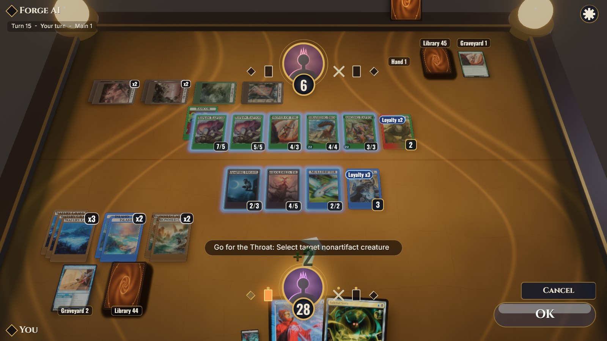

</div>

---

## Gallery

| | |
|:---:|:---:|
| 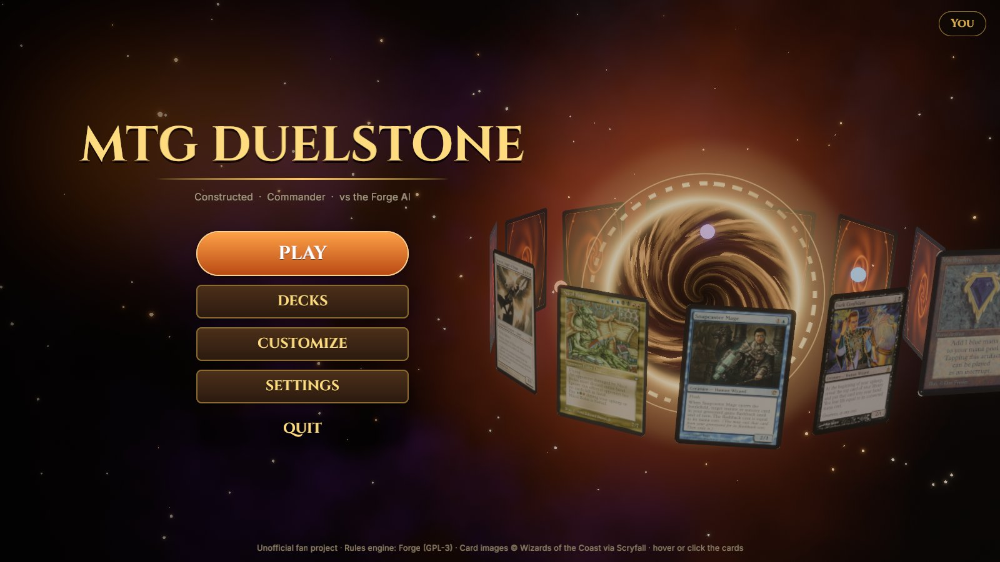 | 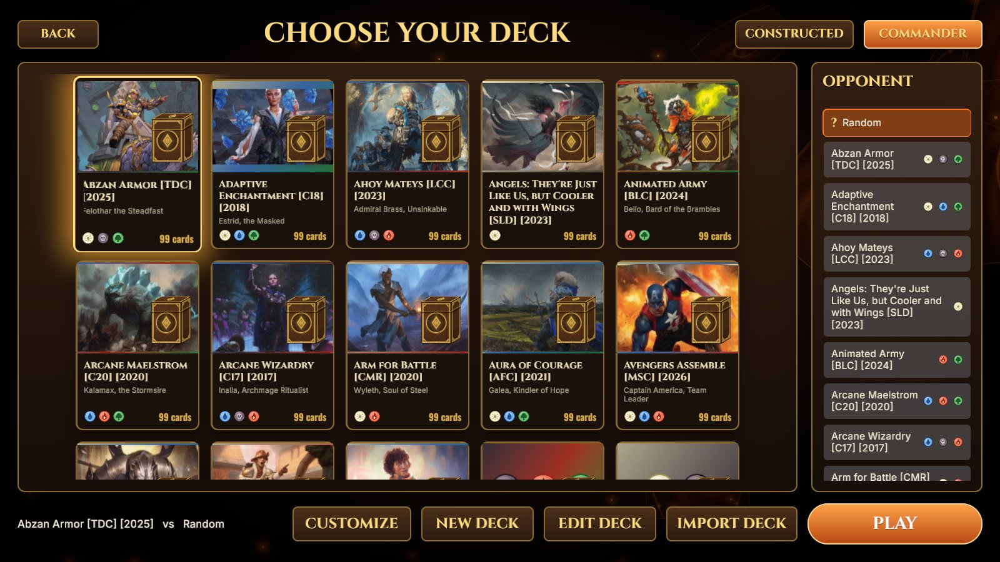 |
| **Main menu.** Animated card-back backdrop, Play · Decks · Settings | **Choose your deck.** Constructed ↔ Commander, pick the AI's deck or Random, import your own |
| 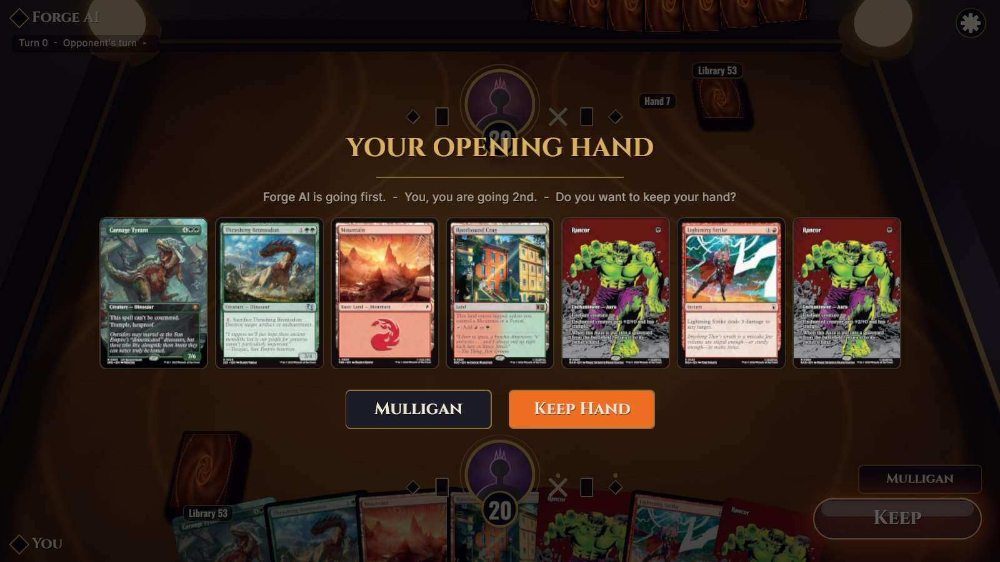 | 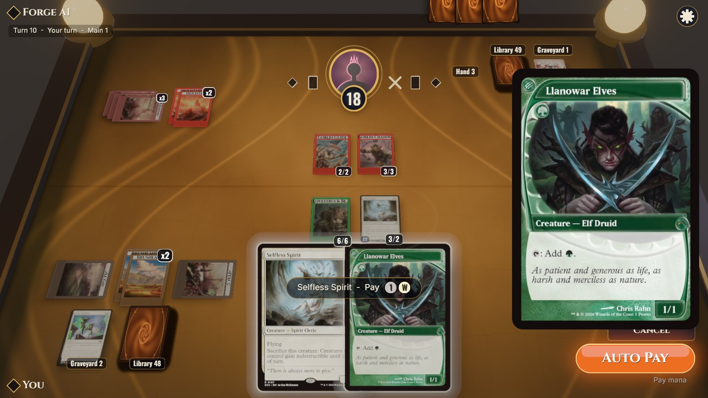 |
| **Opening hand.** Keep or mulligan | **Hover preview & mana payment.** Big card on the right, cost pips, Auto Pay |
| 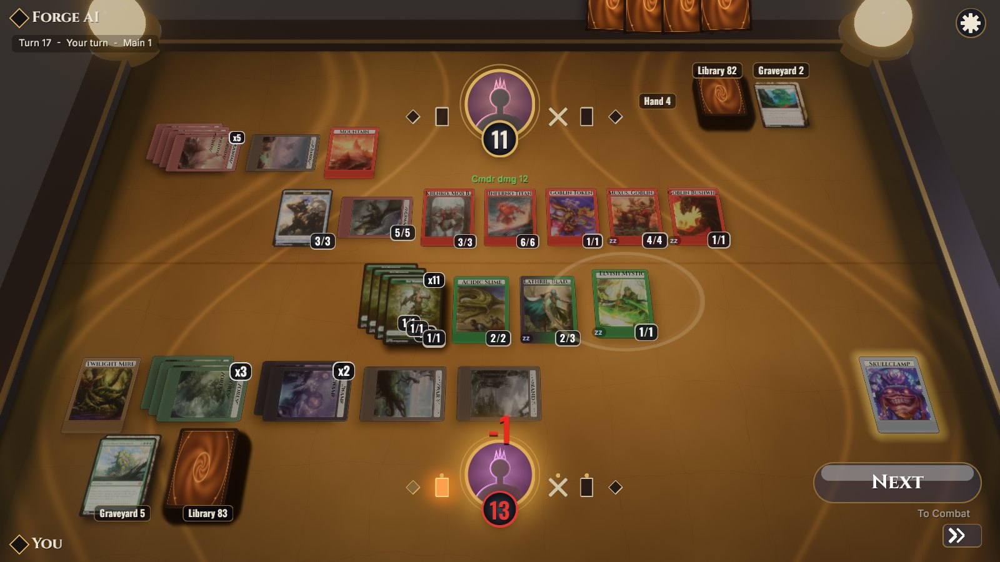 | 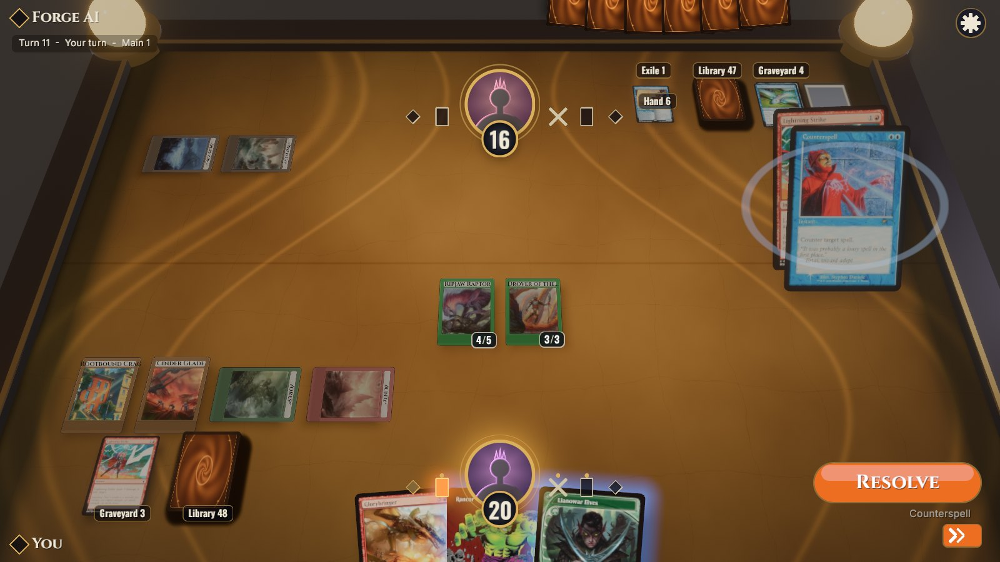 |
| **Commander.** Krenko's goblin tokens stack up (x5), elves (x11), commander damage | **The stack.** The AI counters your spell; the button reads *Resolve* |
| 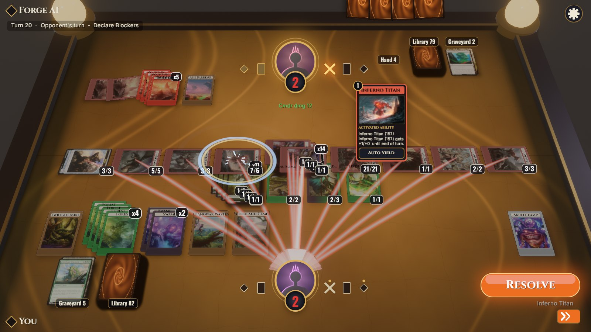 | 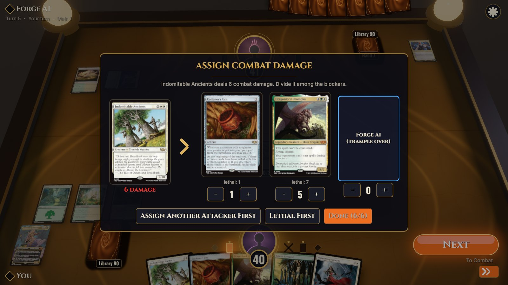 |
| **Combat.** A Commander alpha strike: ribbons to the defender, Inferno Titan's ability on the stack | **Prompts.** Every engine question gets a dialog, e.g. trample damage assignment |

| 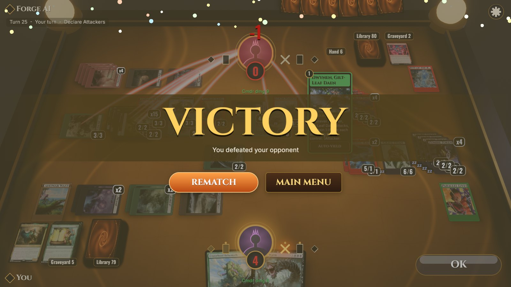 | 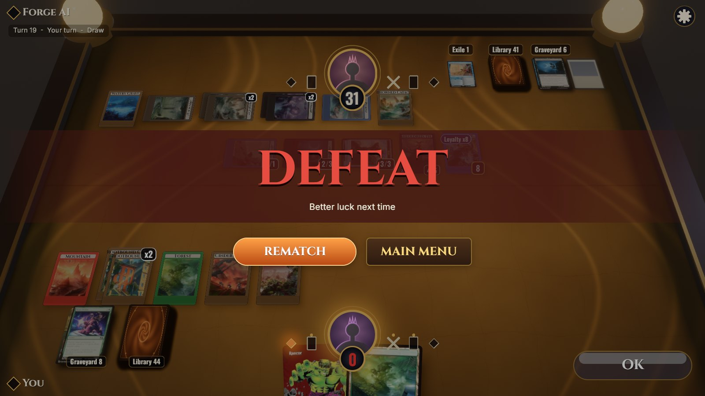 |
|:---:|:---:|
| **Victory.** Confetti, Rematch or back to the menu | **Defeat.** Better luck next time |

## Features

- **Full Magic rules.** The [Forge](https://github.com/Card-Forge/forge) engine (~33 000 scripted cards) runs
  headless and decides everything: priority, the stack, combat, triggers, layers, mulligans and the AI. The
  client never computes legality. It renders what the engine says and answers its questions.
- **Arena-style table.** Perspective camera over a themed playmat (Sanctum, Jungle, Storm), fanned hand on its
  own overlay camera, lands and tokens grouped into "x4" stacks, piles with counters, a stack column and a big
  hover preview.
- **Art-framed battlefield cards.** A custom WGSL material puts the art crop in a frame coloured by the card's
  colours, with name bars, P/T plates (buffs blue, damage red), loyalty and counter badges, and glow rims for
  playable, selected and targetable cards.
- **Readable interaction.** Glowing bezier targeting arrows, attack and block ribbons, the Arena orange action
  button ("Next / To Combat", "Attack with 3", "No Blocks"…), phase track with stop toggles, auto-yield per
  stack item, a game log and undo.
- **Every prompt kind.** Confirm, options, ability choice, card trays, ordering triggers, combat damage
  assignment, distribute amounts, scry/surveil, X values and the mulligan screen.
- **Feel.** Spring-damped card motion, floating damage numbers, hit shake, spark bursts, land-drop dust, turn
  banners, victory confetti, synthesized sound effects and ambient music that crossfades between menus and
  matches.
- **Multiplayer, up to 4 players.** Host a table, send the invite link, and friends join from any browser —
  no install. Empty seats can be filled with the Forge AI; three- and four-player games lay the opponents out in
  columns across the far side of the table. Constructed and Commander (free-for-all).
- **Runs in the browser.** The same Bevy client compiles to WebAssembly (WebGL2); the engine serves it.
- **Decks.** Four Constructed and two Commander starter decks, Forge's precon and theme decks, and an importer
  for pasted lists (Arena/MTGO/Moxfield formats) that shows unresolved names with suggestions.

## Quick start

You need Rust (edition 2024), the usual Bevy system libraries (ALSA, udev, Vulkan), JDK 17 + Maven for the
engine and about 1 GB of disk for Forge.

```bash
tools/install-toolchain.sh        # JDK 17 + Maven into ~/.local/opt (skip if you have them)
source tools/env.sh
tools/setup-forge.sh              # clone Forge (pinned tag) into ./forge and install it to ~/.m2
                                  #   or reuse a checkout:  ln -s /path/to/forge forge
./run.sh                          # builds the engine jar if stale, then runs the game
```

The game starts the engine for you (port 8080) and stops it when you quit. Card images are fetched through the
engine's Scryfall proxy on first use and cached on disk, so the first match needs network access.

Skip the menus and jump straight into a game:

```bash
./run.sh --quick --format constructed --deck starter:gruul-dinosaurs --ai-deck random
./run.sh --quick --format commander --deck starter:lathril-elves
```

## Multiplayer

1. **Host:** *Multiplayer → Host a table*, pick 2–4 players and your deck. The lobby shows an invite link like
   `http://192.168.1.20:8080/?join=K7QF2M` — press **Copy link** and send it.
2. **Friends:** open the link in a browser (Chrome, Firefox, Edge or Safari with WebGL2), pick a deck, **Take seat**.
   Desktop players can paste the link or code into *Multiplayer → Join a table* (or `./run.sh --join <link>`).
3. **Host:** add Forge AI to any empty seat you want filled, then **Start game**.

For browser invitees the engine must serve the web client — build it once:

```bash
tools/build-web.sh        # → web/dist (≈60 MB wasm, sent gzipped ≈13 MB); the engine picks it up automatically
./run.sh --web            # desktop host, rebuilding the browser client first if it is stale
./run.sh --serve          # no desktop window: everyone, host included, plays at http://<this machine>:8080/
```

The invite uses this machine's LAN address, so it works for people on the same network. To play over the
internet, make the engine reachable (port forward, VPN such as Tailscale, or a tunnel) and tell it its public
address: `java -jar engine/target/forge-ws-server.jar --public-url https://my-tunnel.example` (or set
`ARENA_PUBLIC_URL`). Anyone with the link can take an open seat; seats themselves are protected by per-player tokens.

Short on friends? Fill seats with headless bots that play over the real protocol:
`cargo run -p mtg_client --bin autopilot -- --engine http://127.0.0.1:8080 --join <link> --bots 2`.

<details>
<summary><b>All command-line flags</b></summary>

| flag | meaning |
|---|---|
| `--quick` | skip the menus, straight into a match (uses your last format; random decks if none given) |
| `--format constructed\|commander` | game format |
| `--deck REF`, `--ai-deck REF` | decks as listed by the engine (`starter:…`, `theme:…`, `precon:…`, `user:…`, `random`) |
| `--seed N` | engine RNG seed |
| `--join LINK-OR-CODE` | join a multiplayer table (browser: open the link, i.e. `/?join=CODE`) |
| `--engine URL`, `--no-autolaunch` | use an engine that is already running |
| `--autoplay` | a built-in bot plays your seat (demos, screenshots) |
| `--screenshot out.png --exit-after SECS` | save a frame and quit |
| `--record f.jsonl`, `--replay f.jsonl` | record engine frames / replay them with no engine |

`cargo run -p arena --features dev` enables Bevy dynamic linking for fast rebuilds.
</details>

## Controls

| input | action |
|---|---|
| **Click** a card | play it, activate it, or pick it as a target (the engine decides what's legal) |
| **Drag** a hand card onto the table | play it |
| **Hover** / **right-click** | large preview / inspector |
| `Space` / `Enter` | the orange action button (Next, Pass, Attack, Done) |
| `Ctrl+Space`, `F` | pass until something happens |
| `A` | attack with everything |
| `Z` | undo, where the engine allows it |
| `L` | game log |
| `Esc` | close preview or menu; cancel |
| `F8` / `F10` / `F12` | name plates / settings / screenshot |

## How it works

```
┌─────────────────────────── Bevy app (crates/arena) ───────────────────────────┐
│ net → view ──diff──▶ BoardEvent ──▶ fx · audio · motion                       │
│        │ GameView / CurrentInput / PendingPrompt                              │
│        ▼                                                                      │
│ layout (pure fns) → TargetPlacement → motion (springs) → cards on 2 cameras   │
│ interact · hud · prompts · targeting · combat · stack ──▶ SendCmd ──▶ net     │
└──────────────────────────────┬────────────────────────────────────────────────┘
               mtg_client: WS thread + REST + launcher   (mtg_protocol: serde types)
                               │  ws://…/ws/match/{id}   JSON frames: state · input · prompt · events
┌──────────────────────────────▼────────────────────────────────────────────────┐
│ engine/  forge-ws-server (Java 17, Jetty) ─ Forge rules engine + Forge AI      │
└───────────────────────────────────────────────────────────────────────────────┘
```

- The engine sends a full `state` snapshot (hidden information redacted), an `input` describing what it's
  waiting for, blocking `prompt`s answered by index, and `events` animation cues. See
  [engine/docs/protocol.md](engine/docs/protocol.md).
- `view` diffs consecutive snapshots into `BoardEvent`s (card moved, damaged, life changed…), which drive
  animation, effects and sound.
- `layout` is a set of pure, unit-tested functions from game state to card poses. `motion` springs every card
  toward its pose, so drawing, casting, resolving and dying are all just "the target moved".
- Plugins only talk through [`crates/arena/src/shared.rs`](crates/arena/src/shared.rs), so each module can be
  read and changed on its own.

```
crates/mtg_protocol   serde types for every frame (no Bevy)
crates/mtg_client     WS link, REST, engine launcher, recorder/replayer, autoplay policy, autopilot bot
crates/arena          the game: one Plugin per module + assets (fonts, textures, shaders, sfx)
engine/               forge-ws-server: Forge + format selection, art crops, event cues
decks/                starter decks
```

## Development

```bash
cargo test --workspace                                                   # protocol, client, layout, view, prompts
cargo run -p mtg_client --bin autopilot -- --launch --format constructed --games 10   # headless soak vs the AI
cargo run -p mtg_client --bin autopilot -- --launch --format commander --players 4 --games 3   # 4 bots at one table
tools/build-web.sh --dev                                                 # quicker browser build for iterating
cargo run -p arena -- --replay crates/arena/tests/replays/commander_mid.jsonl --engine http://127.0.0.1:8080
python3 crates/arena/assets/tools/gen_textures.py                        # regenerate card back, playmats, icons
python3 crates/arena/assets/tools/gen_sfx.py                             # regenerate sound effects and music
```

See [PLAN.md](PLAN.md) for the design and roadmap and [CLAUDE.md](CLAUDE.md) for working notes.

## License & legal

This project is licensed under the **GNU GPL v3.0** (see [LICENSE](LICENSE)) because `engine/` links against
Forge, which is GPL-3. Fonts are OFL (Cinzel, Oswald, Inter); textures, icons and sounds are generated by the
scripts in `crates/arena/assets/tools/`.

Magic: The Gathering, its card names, art and images are © Wizards of the Coast. This is an unofficial fan
project, not affiliated with or endorsed by Wizards of the Coast, and is intended to fall under the
[Fan Content Policy](https://company.wizards.com/en/legal/fancontentpolicy). **No card images are included or
redistributed**: they are fetched at runtime from [Scryfall](https://scryfall.com). "MTG Arena" refers only to
the interface style that inspired this client.
